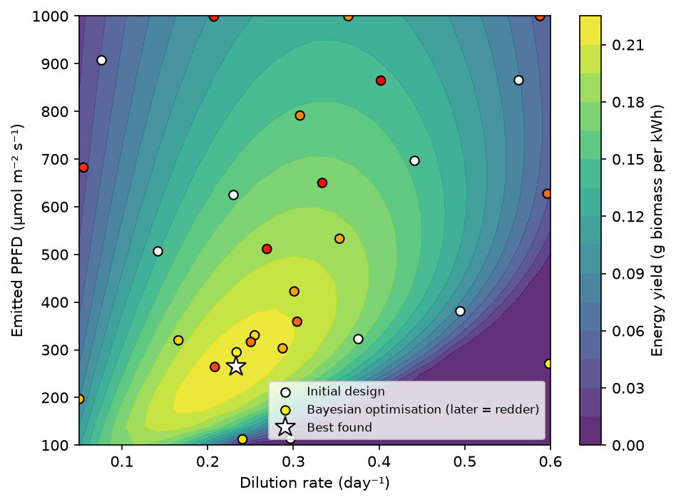
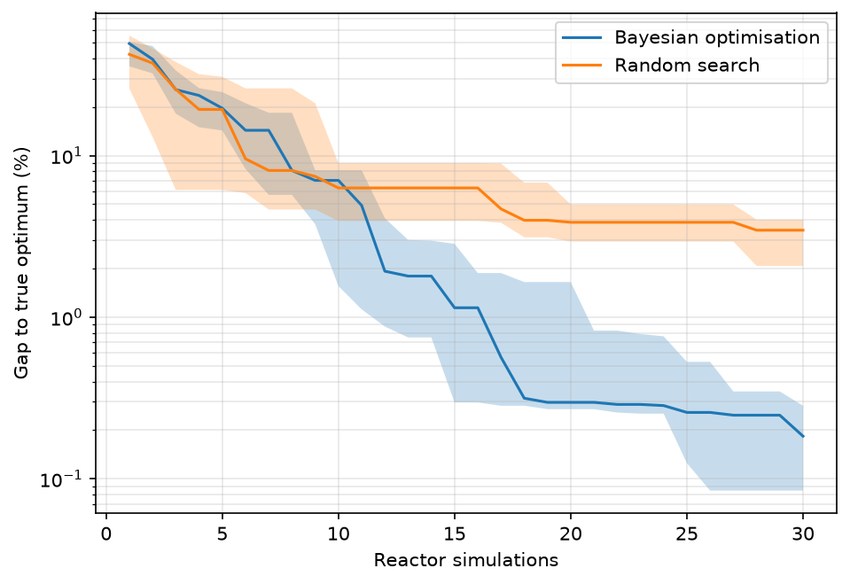

# Bayesian optimisation of a photobioreactor

Finds the light intensity and dilution rate that give a tubular photobioreactor the most biomass per unit of electricity, using as few reactor simulations as possible.

The reactor is a Python port of my [Julia photobioreactor model](https://github.com/Leukwarmpotato/tubular-photobioreactor-model): 606 stiff ODEs for a CSTR-PFR loop growing *Dunaliella salina*, solved to steady state. Each simulation takes under a second here, so the true optimum can be mapped on a grid and the optimiser scored against it. The same code applies unchanged to a simulator, or an experiment, where every evaluation is expensive.

<p align="center"></p>

## Results

Budget of 30 simulations per run, 10 random seeds, compared against a reference optimum from a 25×25 grid (625 simulations) refined with Nelder-Mead.

| Method | Median gap to optimum | Runs within 1% | Median simulations to reach 1% |
|---|---|---|---|
| Bayesian optimisation | 0.18% | 9 of 10 | 15 |
| Random search | 3.46% | 1 of 10 | 18 |

The optimum is at about 250 µmol m⁻² s⁻¹ and a dilution rate of 0.22 day⁻¹, giving 0.220 g of biomass per kWh. That is 60% more than the original design point (600 µmol m⁻² s⁻¹, 0.17 day⁻¹, 0.136 g per kWh), at the cost of lower total output: growth saturates with light, so dimmer light is used more efficiently.

<p align="center"></p>

Lines are medians over the 10 seeds and bands are the interquartile range. One of the ten runs stalled 3% short of the optimum, which is discussed under next steps.

## How it works

1. Eight starting points are spread over the search space with a Sobol sequence and simulated.
2. A Gaussian process with a Matérn 5/2 kernel is fitted to all results so far. It gives a prediction and an uncertainty everywhere in the space.
3. Expected improvement scores 4,096 candidate points by how much each is likely to beat the best result so far, which balances trying promising regions against exploring uncertain ones.
4. The best-scoring candidate is simulated, and steps 2 to 4 repeat.

The objective has a cliff: at low light and fast dilution the algae wash out and the yield drops to zero, which makes it harder for a smooth surrogate than a simple hill.

## Layout

| Path | Purpose |
|---|---|
| `src/pbr_bayesopt/reactor.py` | Reactor model and steady-state solver |
| `src/pbr_bayesopt/objective.py` | Search bounds and the quantity being maximised |
| `src/pbr_bayesopt/optimiser.py` | Gaussian process, expected improvement, optimisation loop, random search |
| `src/pbr_bayesopt/plots.py` | Figures |
| `src/pbr_bayesopt/cli.py` | Command-line interface |
| `tests/` | Checks on the reactor model and the optimiser |

## Running

Requires [uv](https://docs.astral.sh/uv/).

```bash
uv sync
uv run pytest
uv run pbr-bayesopt reference    # grid map and true optimum, about 3 minutes
uv run pbr-bayesopt optimise     # one run, prints each step
uv run pbr-bayesopt compare      # 10 seeds against random search
```

Add `--target productivity` to any command to maximise volumetric productivity instead of energy yield. `uv run pbr-bayesopt optimise --help` lists the other options.

## Next steps

- Make the optimiser more robust. One run in ten stalled 3% short of the optimum, and the cause has not been diagnosed yet. A different exploration weight or a local refinement step around the best point are the first things to try.
- Add CO₂ inlet fraction and mass transfer coefficient as search variables, where a grid search stops being practical.
- Treat productivity and energy yield as two objectives and map the trade-off between them.
- Compare against a library implementation such as BoTorch.
